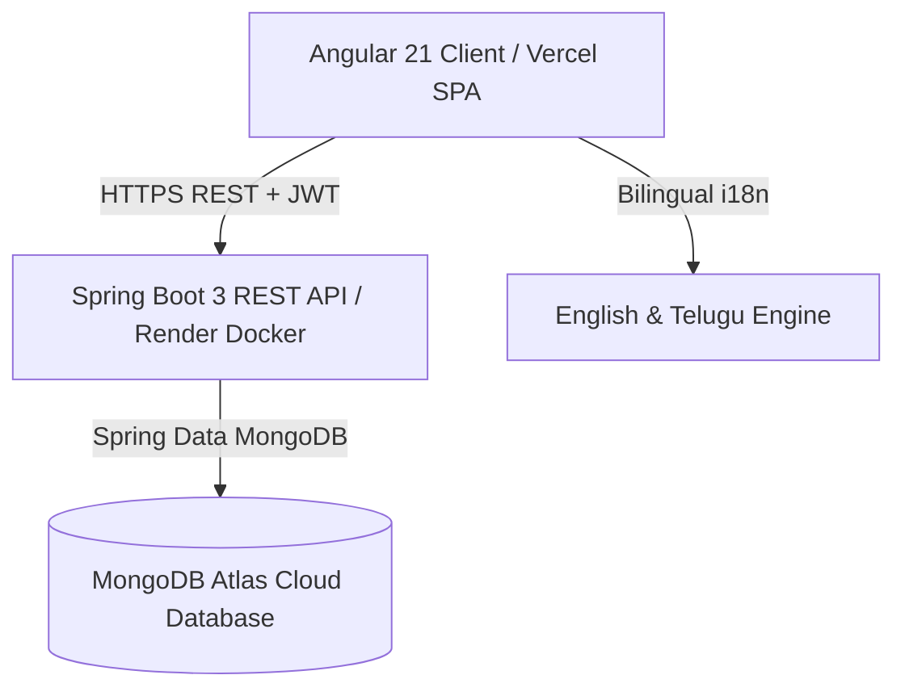

# 🏸 Smash Club — Premium Badminton Group & Financial Management

[](https://spring.io/projects/spring-boot)
[](https://angular.dev/)
[](https://www.mongodb.com/atlas)
[](LICENSE)

**Smash Club** is a premium, full-stack badminton group management and financial settlement web application. Tailored for badminton cohorts (starting with 7 initial players and scaling to $N$ players), it provides court session scheduling, attendance tracking, exact-arithmetic expense splitting, UPI payment verification, and automated peer-to-peer debt simplification in **INR (₹)** and **Asia/Kolkata** timezone.

---

## 🎨 Visual Aesthetics & Design System
- **Theme**: Dark charcoal background (`#090D16`, `#111827`) paired with vibrant neon badminton lime accents (`#A3E635`, `#84CC16`).
- **Typography**: Google Fonts [Outfit](https://fonts.google.com/specimen/Outfit) and [Plus Jakarta Sans](https://fonts.google.com/specimen/Plus+Jakarta+Sans).
- **Cards & Glassmorphism**: Translucent backdrop-blur cards with subtle glowing borders (`rgba(163, 230, 53, 0.2)`).
- **Localization**: Full English and Telugu (తెలుగు) bilingual support with persistent language preference.

---

## 🌟 Key Features

### 1. Role-Based Access Control
- **Club Administrator (`ROLE_ADMIN`)**:
  - Full player roster management (add, edit, deactivate, invite members).
  - Create & schedule games with court booking fees, shuttlecock costs, and extra refreshments.
  - Record actual attendees and preview financial recalculation before confirming.
  - Choose between **Equal Split**, **Custom Fixed Amount (₹)**, or **Custom Percentage (%)**.
  - Record, approve, and audit payments (UPI, Cash, Bank Transfer).
  - Manage settlements and organizer reimbursements.
  - Searchable game history, date filters, and CSV data exports.
- **Player Member (`ROLE_PLAYER`)**:
  - View upcoming games and countdowns.
  - View itemized share breakdown per game session.
  - View personal payment history and outstanding balance.
  - Interactive UPI QR Code simulator for quick clearance.
  - Instant toggle between English and Telugu (తెలుగు).

### 2. Precision Financial Engine (`BigDecimal`)
- Built with Java `BigDecimal` exact arithmetic and scale of 2.
- **Exact Penny Remainder Reconciliation**: When splitting amounts like ₹100 among 3 players or ₹840 among 6 players:
  - Base share: $\lfloor 840 / 6 \rfloor = ₹140.00$.
  - Odd remainders (e.g., ₹100.00 / 3) allocate $₹33.34$ to the first player and $₹33.33$ to the others, ensuring $\sum \text{Shares} \equiv \text{Total Expense}$ down to the last paisa.
- **Debt Simplification (Minimizing Cash Flow)**:
  - Net balance solver: calculates who owes whom and reduces circular debts into minimal peer-to-peer transfers.

---

## 🏗️ System Architecture



### MongoDB Collections
1. `users` — Credentials, BCrypt passwords, role (`ROLE_ADMIN` / `ROLE_PLAYER`), language preference.
2. `players` — Roster profile, unique ID (`SC-001`, `SC-002`, ...), contact, avatar, financial summary.
3. `games` — Court name, venue location, date, start/end time, court cost, shuttle expenses, organizer.
4. `game_participants` — Attendance records, share allocations, payment status.
5. `expenses` — Recorded court session costs, payer ID, split model.
6. `expense_allocations` — Individual member allocations, paid amounts, balance amounts.
7. `payments` — Unique payment reference, payer, payee (organizer), amount, UPI UTR reference, status.
8. `settlements` — Resolved debts, reimbursement records, settlement timestamps.
9. `group_settings` — Club parameters, default court fee, default shuttle cost, announcements.
10. `audit_logs` — Immutable audit trail of administrative actions.

---

## 🚀 Local Development Setup

### Prerequisites
- **Java 17+** (JDK 17 LTS)
- **Apache Maven 3.6+**
- **Node.js 20+** & **npm 11+**
- MongoDB instance (Local or MongoDB Atlas free cluster)

### 1. Clone & Configure
```bash
git clone https://github.com/<your-username>/smash-club.git
cd smash-club
cp .env.example .env
```

### 2. Run Backend (Spring Boot)
```bash
cd backend
mvn clean test        # Run all financial calculation & security unit tests
mvn spring-boot:run   # Launches on http://localhost:8080
```

> **Default Seed Data**: On initial startup, the backend automatically seeds the 7 core Smash Club players, demo users, past game session with ₹840 expense split among 6 players, payments, and upcoming games!

### 3. Run Frontend (Angular)
```bash
cd ../frontend
npm install
npm start            # Launches on http://localhost:4200
```

Open your browser at `http://localhost:4200`.

---

## 🌐 Cloud Deployment Guide

### A. MongoDB Atlas (Cloud Database)
1. Sign in to [MongoDB Atlas](https://www.mongodb.com/atlas).
2. Create a free **M0 Sandbox** cluster (AWS, Mumbai `ap-south-1` or Singapore `ap-southeast-1`).
3. Under **Database Access**, create a user (e.g. `smash_admin`) with password and read/write privileges.
4. Under **Network Access**, add IP `0.0.0.0/0` (Allow access from anywhere, required for cloud containers).
5. Click **Connect** -> **Drivers** -> Copy the connection string:
   ```text
   mongodb+srv://smash_admin:<PASSWORD>@cluster0.xxxxx.mongodb.net/smashclub?retryWrites=true&w=majority
   ```

### B. Render.com (Spring Boot Backend via Docker)
1. Sign in to [Render.com](https://render.com).
2. Click **New +** -> **Web Service** -> Connect your GitHub repository.
3. Select **Docker** environment (Render will automatically detect `backend/Dockerfile`).
4. Configure Environment Variables in the Render Dashboard:
   - `PORT`: `8080`
   - `SPRING_PROFILES_ACTIVE`: `prod`
   - `MONGODB_URI`: `mongodb+srv://smash_admin:<PASSWORD>@cluster0.xxxxx.mongodb.net/smashclub?retryWrites=true&w=majority`
   - `JWT_SECRET`: `404E635266556A586E3272357538782F413F4428472B4B6250645367566B5970`
   - `CORS_ALLOWED_ORIGINS`: `https://smash-club.vercel.app,http://localhost:4200`
5. Click **Deploy Web Service**.
6. Verify deployment by visiting: `https://<your-render-app>.onrender.com/api/health`.

### C. Vercel (Angular Frontend)
1. Sign in to [Vercel](https://vercel.com).
2. Click **Add New** -> **Project** -> Import your GitHub repository.
3. Configure Project Settings:
   - **Root Directory**: `frontend`
   - **Framework Preset**: `Angular`
   - **Build Command**: `npm run build`
   - **Output Directory**: `dist/frontend/browser` (or `dist/frontend`)
4. In `frontend/src/environments/environment.prod.ts`, set:
   ```typescript
   export const environment = {
     production: true,
     apiUrl: 'https://<your-render-app>.onrender.com/api'
   };
   ```
5. Deploy! Vercel will build and serve the application globally with CDN acceleration.

---

## 🧪 Verification & Unit Testing

Execute backend test suite:
```bash
cd backend
mvn test
```

### Verified Test Cases:
| Test Class | Test Case | Status |
| :--- | :--- | :---: |
| `FinancialCalculatorTest` | Exact split of ₹840.00 among 6 players into ₹140.00 each | ✅ PASS |
| `FinancialCalculatorTest` | Remainder penny reconciliation (₹100 / 3 = ₹33.34 + ₹33.33 + ₹33.33) | ✅ PASS |
| `FinancialCalculatorTest` | Custom fixed split sum validation | ✅ PASS |
| `FinancialCalculatorTest` | Custom percentage allocation & 100% boundary check | ✅ PASS |
| `FinancialCalculatorTest` | Debt simplification (cash flow minimization) | ✅ PASS |
| `PaymentServiceTest` | Duplicate transaction reference (UTR) rejection | ✅ PASS |
| `PaymentServiceTest` | Admin automatic approval vs player verification queue | ✅ PASS |

---

## 🔑 Default Credentials & Demo Mode

For quick evaluation, Smash Club includes an instant **One-Click Role Switcher** in the top navigation bar to toggle between Admin and Player views without re-authenticating.

You can also log in directly:
- **Admin**: Username: `admin` | Password: `SmashAdmin123!`
- **Player (Ananya Sharma)**: Username: `player` | Password: `SmashPlayer123!`
- **Individual Players**: Username: `karthik`, `priya`, `rahul`, `sneha`, `arjun` | Password: `Smash@123`

---

## 📄 License
This project is open-source and licensed under the [MIT License](LICENSE).
